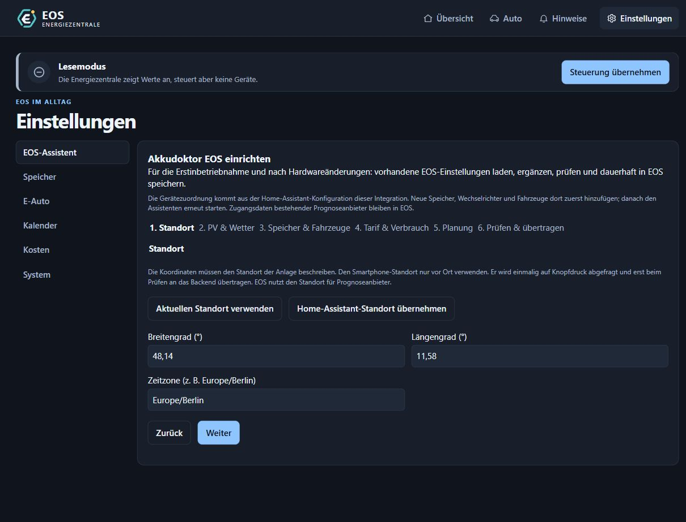
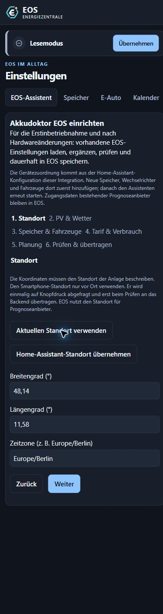

# EOS-Einrichtungsassistent

Unter **Einstellungen → EOS-Assistent** lässt sich Akkudoktor EOS für die
Energiezentrale einrichten oder nach Hardwareänderungen abgleichen. Der Assistent
nutzt die EOS-Konfigurations-API und benötigt keinen Besuch der EOS-Oberfläche.
Er steht wie das übrige Panel nur Home-Assistant-Administratoren zur Verfügung.

## Voraussetzungen

- EOS ist installiert, gestartet und über die in der Integration hinterlegte
  API-Adresse erreichbar. Die Installation des EOS-Servers übernimmt der Assistent
  nicht.
- Die EOS-Version bietet `/v1/config`, `/v1/config/file`, OpenAPI sowie die
  Batterie-/Wechselrichter-Profil-API. Der Assistent prüft die schreibbaren Felder
  gegen das Schema der verbundenen Instanz und bricht bei fehlender Unterstützung ab.
- Speicher, Wechselrichter und Fahrzeuge zuerst in der Home-Assistant-Konfiguration
  der Energiezentrale hinzufügen. Die dort zugeordneten EOS-Kennungen, bekannten
  Kapazitäten, Leistungsgrenzen und Speicher-SoC-Grenzen werden übernommen. So
  stimmen die spätere Messwertübertragung und Gerätesteuerung mit EOS überein.

## Ablauf

1. Die Gerätesteuerung über **Steuerung zurückgeben** beenden. Unbestätigte
   Gerätefreigaben zuerst beheben. Danach die bestehende Konfiguration laden.
2. **Standort:** Koordinaten prüfen, den Home-Assistant-Anlagenstandort übernehmen
   oder vor Ort den Smartphone-Standort verwenden. Die Anlagenzeitzone prüfen.
3. **PV & Wetter:** pro Ausrichtung eine PV-Fläche mit kWp, Neigung, Ausrichtung,
   AC-Leistung und Verlusten anlegen. Norden entspricht 0°, Osten 90°, Süden 180°,
   Westen 270°. Ohne PV keine Fläche anlegen und die leere Einstellung beibehalten.
4. **Speicher & Fahrzeuge:** Gerätezuordnungen und Profile prüfen. Bekannte
   Hardwaregrenzen sind übernommen und werden in der HA-Konfiguration geändert.
   Fehlt die Speicherkapazität, kann sie für EOS angegeben werden. Die
   Wechselrichter-Nennleistung und dessen Zuordnung prüfen. Weitere, nicht von der
   Energiezentrale verwaltete EOS-Geräte werden nicht entfernt.
5. **Tarif & Verbrauch:** einen Festpreis oder einen verfügbaren dynamischen
   Anbieter wählen. Dynamische Preise verwenden einen Netto-Aufschlag und eine
   prozentuale Steuer. Ein fester Netzpreis wird brutto eingegeben und erhält keine
   zusätzlichen Bezugsaufschläge. Für Tarife mit Tageszeiten (z. B. Octopus Go mit
   günstigem Nachtstrom) bis zu 12 Preiszonen anlegen: Jede Zone gilt ab ihrer Uhrzeit
   bis zur nächsten, die letzte über Mitternacht bis zur ersten, an jedem Tag. Für
   Octopus Go also eine Zone ab 00:30 mit dem Nachtpreis und eine ab 05:30 mit dem
   Tagespreis. EOS erhält daraus Zeitfenster, die nicht über Mitternacht laufen; ein
   vorhandener Tarif aus solchen Zeitfenstern wird beim Laden wieder als Zonen
   angezeigt. Tarife mit Wochentagen, Monaten oder Datumsangaben kann der Assistent
   nicht abbilden; dafür „Beibehalten“ wählen. Einspeisevergütung und Jahresverbrauch ohne
   separat optimierte Fahrzeugladung ergänzen. Bestehende andere Anbieter können
   einschließlich ihrer Zugangsdaten beibehalten werden. Neu auswählbar sind
   Anbieter ohne zusätzliche Zugangsdaten: Akkudoktor/Forecast.Solar für PV sowie
   Energy-Charts, Akkudoktor und SMARD für Netzpreise.
6. **Planung:** Planungshorizont, Prognosezeitraum und Neuberechnungsintervall
   prüfen. Der Prognosezeitraum muss auch einen bereits konfigurierten
   GENETIC-Nachlauf abdecken. Die Energiezentrale übernimmt Messwertübertragung
   und Gerätesteuerung; EOS-Geräteadapter werden daher abgeschaltet.
7. **Prüfen & übertragen:** Änderungen vergleichen, bestätigen und in EOS
   übernehmen. EOS muss die Werte, wirksamen Profilgrenzen und die dauerhafte
   Speicherung bestätigen. Die Vorschau gilt zehn Minuten und wird bei geänderten
   betroffenen EOS-Werten oder einer anderen Hardwarezuordnung zurückgewiesen.

Der Assistent verändert gezielt seine Konfigurationsfelder. Er überträgt weder die
vollständige gelesene Konfiguration noch maskierte Zugangsdaten zurück an EOS.
Die Tarifhistorie der **Kostenbilanz** bleibt separat unter **Kosten** konfiguriert.
Ohne separaten Strompreis-Sensor oder Plugin-Preis liest die Energiezentrale den
aktuellen Bezugspreis automatisch aus den EOS-Preisprognosen einschließlich der
dort konfigurierten Aufschläge. Die Anzeige, Messhistorie und Kostenbilanz nutzen
diesen gemeinsamen Wert; ein fertiger Optimierungsplan ist dafür nicht nötig.
Solange EOS noch keine aktuellen Preisdaten bereitstellt, bleibt der Preis
unbekannt und ein Verfügbarkeitshinweis sichtbar. In der Quellendiagnose steht
dafür **EOS: Akkudoktor EOS**.

Nach dem Übertragen werden aktuelle Gerätewerte erneut an EOS gesendet. Neue
Fahrzeuge starten in EOS ohne Ladefreigabe, bis die normale Synchronisierung der
Energiezentrale ihren Zustand bestätigt. Prognosen und ein neuer Plan können einige
Minuten benötigen. Die Steuerung bleibt aus und wird anschließend selbst
freigegeben. Pläne, die vor der Konfigurationsänderung erzeugt wurden, werden auch
nach einem HA-Neustart nicht verwendet.

## Smartphone-Standort

**Aktuellen Standort verwenden** fragt die Browser-Geolocation genau einmal ab.
Der Browser kann dafür eine Berechtigung verlangen. Den Knopf nur am Standort der
Anlage verwenden; es gibt keine laufende Ortung. Die Koordinaten bleiben zunächst
im Formular und werden erst mit **Änderungen prüfen** an das authentifizierte
Backend geschickt. Nach Bestätigung speichert EOS sie als Anlagenstandort und
kann sie für externe Prognoseanbieter verwenden. Die Energiezentrale schreibt
keine Koordinaten oder Zugangsdaten in ihre Diagnoselogs.

Geolocation benötigt einen sicheren Browserkontext, normalerweise HTTPS oder
localhost. Bei Zugriff über `http://homeassistant.local:8123` kann der Browser sie
verweigern. Manuelle Eingabe und die Übernahme des Home-Assistant-Standorts stehen
weiterhin zur Verfügung. Das gilt auch bei abgelehnter Berechtigung oder nicht
verfügbarer Ortung.

Smartphone-Ansicht mit synthetischen Beispieldaten

## Wenn eine Bestätigung fehlt

Bei Zeitüberschreitungen oder nicht bestätigter Speicherung können Werte in EOS
bereits aktiv sein. Der Assistent zeigt dies als Fehler und wiederholt den
Schreibvorgang nicht automatisch. Die Konfiguration neu laden, prüfen und eine
neue Vorschau erstellen. Alte Pläne bleiben gesperrt. Probleme erscheinen außerdem
in den Hinweisen und im Home-Assistant-Log, ohne rohe Antworten oder Zugangsdaten.

API-Vertrag: [offizielles EOS-OpenAPI-Schema](https://github.com/Akkudoktor-EOS/EOS/blob/main/openapi.json).
Die Backendtests verwenden einen reduzierten Auszug der Eingabeschemas vom
22. November 2026 und prüfen zusätzlich Konflikte, Bestätigungen, Profile,
Datenschutz und die Plansperre. Eine echte Anlage wird in Tests nicht verändert.
