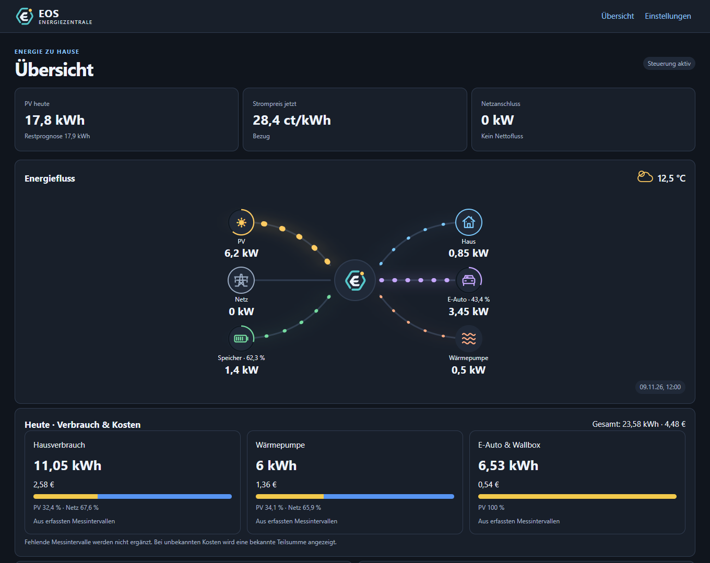
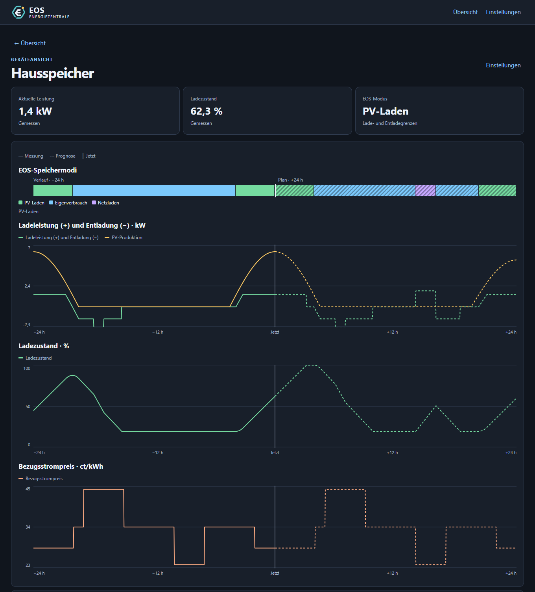
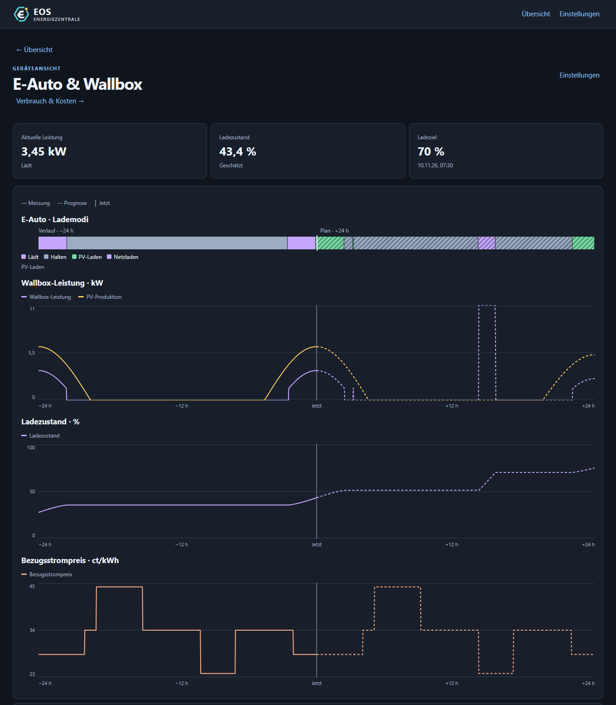
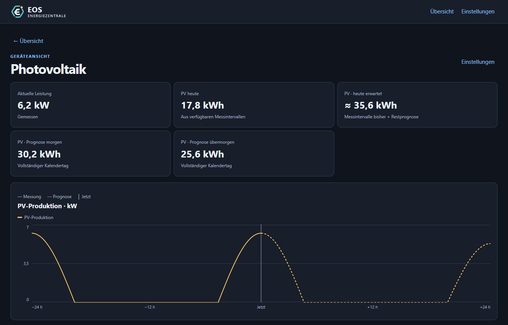
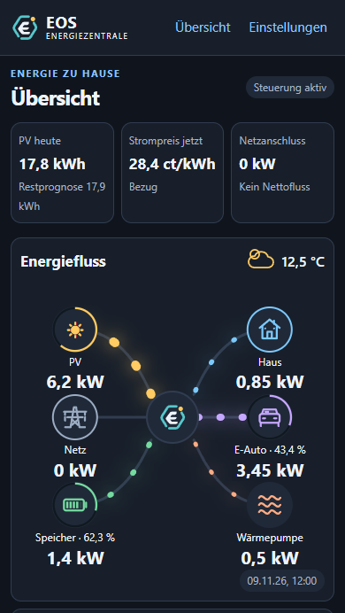

<p></p>

# EOS Energiezentrale

Victron-Anlagen über die offizielle **Victron GX**-Integration oder
**Victron Venus MQTT / HACS** anbinden:
[Plugin einrichten](VICTRON.md) (Messwerte und optionale ESS-Mode-2-Steuerung).
Alternativ [Victron GX direkt über Modbus TCP](VICTRON_MODBUS.md) anbinden,
ohne zusätzliche Victron-Integration oder HA-Sensoren.

HACS-Custom-Integration für Akkudoktor EOS mit animiertem Stromfluss, Prognosen,
Speichersteuerung und PV-Überschussladen. Ab Version **0.2.0** läuft die
Energiezentrale direkt in Home Assistant. Der EOS-Server bleibt ein separater Dienst.

[Plugin-Übersicht mit Checkboxen „Getestet und freigegeben“](PLUGINS.md#plugin-übersicht-und-freigabestatus).

## Einblick in die Oberfläche

Die folgenden Screenshots zeigen die aktuelle Oberfläche mit **synthetischen
Beispieldaten**, nicht die Messwerte einer echten Anlage. Sichtbare Geräte und
Prognosen hängen von der eigenen Konfiguration und den verfügbaren Daten ab.
Die Beispieldaten verwenden eine geprüfte Leistungsbilanz; Ladezustände und
Tagesenergien werden aus den Leistungen berechnet. [Modellannahmen](docs/screenshots/README.md#plausibilität-der-beispieldaten).

### Übersicht: Energiefluss, Wetter und Tagesbilanz

Die Übersicht verbindet aktuelle Leistungen und Ladezustände mit dem animierten
Energiefluss. Darunter stehen Tagesverbrauch und Kosten nach Verbrauchern.
Ein Klick auf ein Gerätesymbol öffnet die zugehörige Detailansicht.



### Hausspeicher: Verlauf und EOS-Plan

Die farbige Zeitleiste zeigt vergangene und geplante Betriebsmodi. Darunter stehen
Lade-/Entladeleistung, PV-Produktion, Ladezustand und Strompreis. Durchgezogene
Linien zeigen Messwerte, gestrichelte Linien die Prognose.



<details>
<summary><strong>E-Auto: Ladeleistung, Ladeziel und Prognose</strong></summary>

Die Fahrzeugansicht zeigt Ladeziel und Abfahrtszeit sowie die EOS-Lademodi,
Wallbox-Leistung, PV-Produktion, SoC und Bezugspreise.



</details>

<details>
<summary><strong>Photovoltaik: Ertrag und Tagesprognosen</strong></summary>

Aktuelle PV-Leistung, heutiger Ertrag und Prognosen für heute, morgen und
übermorgen stehen über dem gemeinsamen Verlauf aus Messung und Prognose.



</details>

<details>
<summary><strong>Handyansicht der Übersicht</strong></summary>

Die Oberfläche passt sich schmalen Bildschirmen an. Hier der obere Bereich der
Übersicht; Tagesbilanz und weitere Informationen folgen darunter beim Scrollen.



</details>

## Installation

Voraussetzung: Home Assistant **2026.11.0 oder neuer** und ein erreichbarer
EOS-Server. Für die Installation über den Community Store wird zusätzlich HACS benötigt. Für die Installation über HACS muss das GitHub-Repository öffentlich
erreichbar sein; die Änderungen müssen zuvor nach GitHub übertragen worden sein.

1. HACS → Menü → **Benutzerdefinierte Repositories** öffnen.
2. `https://github.com/szech77/HA_EOS_Akkodoktor_Energiezentrale` hinzufügen,
   Kategorie **Integration** wählen und EOS Energiezentrale herunterladen.
3. Home Assistant neu starten.
4. Einstellungen → Geräte & Dienste → Integration hinzufügen → **EOS Energiezentrale**.
5. EOS-Adresse, Quellsensoren, Hardware und technische Grenzen im Assistenten einrichten.
6. Das Panel **EOS Energiezentrale** in der Seitenleiste öffnen. Messwerte zunächst
   im Lesemodus prüfen. Erst danach die Energiesteuerung einschalten.

Alternativ `custom_components/eos_energiezentrale` nach
`/config/custom_components/eos_energiezentrale` kopieren und HA neu starten.
Eine Aufnahme in den HACS-Standardkatalog ist dafür nicht erforderlich.

## Konfiguration

Die Energiezentrale wird unter **Einstellungen → Geräte & Dienste → Integration
hinzufügen → EOS Energiezentrale** eingerichtet. Spätere Änderungen erfolgen über
**EOS Energiezentrale → Konfigurieren**. Der Dialog ist nach Verbindung, Sensoren,
Hardware, technischen Grenzen und Verlauf gegliedert.

Die Integration unterstützt ausschließlich die Einrichtung über die Oberfläche.
Ein eigener Block `eos_energiezentrale:` in `configuration.yaml` wird nicht
unterstützt. Die weiter unten gezeigten YAML-Beispiele gehören zur
Home-Assistant-InfluxDB-Integration und zu optionalen Template-Sensoren.

### EOS-Verbindung und Sprache

Die Anbindung unterstützt auch die neue EOS-Batterieprofilstruktur, etwa im
Add-on-Build `0.3.0.dev2611122196862169`.
[Kompatibilität, Feldzuordnung und Hinweise bei fehlender Bestätigung](EOS_COMPATIBILITY.md).

| Feld / interner Schlüssel | Beispiel oder Standard | Bedeutung |
|---|---|---|
| EOS-API-Basisadresse / `eos_url` | `http://homeassistant.local:8503` | Erreichbare Adresse des separat laufenden EOS-Servers, einschließlich Port. |
| Panel-Sprache / `language` | `auto` | Übernimmt die Sprache des HA-Frontends. Alternativen: `de`, `en`; Rückfall ist Englisch. |
| EOS-Speicherressource / `battery_resource` | `battery1` | Ressourcen-ID des Hausspeichers im EOS-Plan. |
| EOS-Fahrzeugressource / `vehicle_resource` | `ev1` | Ressourcen-ID des Autos im EOS-Plan. |

Die Adresse enthält nur Schema, Host und gegebenenfalls Port, beispielsweise
`http://192.168.178.56:8503`. Pfade wie `/v1/config` werden von der Integration
angehängt. Zum Prüfen der Erreichbarkeit kannst du im Browser
`http://192.168.178.56:8503/v1/config` öffnen. Die Verbindung muss auch vom
HA-Core-System aus erreichbar sein; `localhost` bezeichnet dessen eigene
Laufzeitumgebung, nicht automatisch eine andere App.

Die Ressourcen-IDs müssen zu deiner EOS-Konfiguration passen und unterschiedlich
sein. Die Integration übernimmt die Zeitzone aus Home Assistant; dafür gibt es
kein eigenes Eingabefeld. Die Sprache nativer HA-Dialoge und Entitäten folgt den
Home-Assistant-Spracheinstellungen; `language` steuert das eigene Panel.

### Quellsensoren

Wähle im Sensor-Dialog die tatsächlichen Entitäts-IDs deiner Installation.
Die folgenden Zuordnungen sind die mitgelieferten Standards und müssen bei
abweichenden Namen ersetzt werden:

| Feld / Schlüssel | Standard-Entität | Erwarteter Wert |
|---|---|---|
| PV-Leistung / `pv_entity` | `sensor.fronius_symo_gen24_pv_power` | Positive Leistung in W oder kW. |
| Gesamter Hausverbrauch / `house_entity` | `sensor.solarnet_leistung_verbrauch` | Positive Leistung in W oder kW, einschließlich Auto und Wärmepumpe. |
| Netzleistung / `grid_entity` | `sensor.fronius_smartmeter_ip_meter_1_power` | W oder kW; positiv = Bezug, negativ = Einspeisung. |
| Wärmepumpenleistung / `heat_entity` | `sensor.wp_strommesser_leistung_w_rmepumpe` | Positive Leistung in W oder kW, einschließlich Standby-Verbrauch. |
| Bezugspreis / `price_entity` | `sensor.blumenstrasse_13_strompreis` | `EUR/kWh`, `€/kWh`, `ct/kWh` oder `c/kWh`. |
| Fahrzeug-SoC / `car_soc_entity` | `sensor.id4_soc` | Numerischer Ladezustand, passend zur folgenden Einheit. |
| Fahrzeug-SoC-Einheit / `car_soc_scale` | `factor` | `factor`: 0–1, beispielsweise `0.33`; `percent`: 0–100, beispielsweise `33`. |

Der dargestellte Hausverbrauch wird so berechnet:

```text
Haus ohne Auto und Wärmepumpe = Gesamtverbrauch − Wallbox-Leistung − Wärmepumpenleistung
```

Der Speicher-SoC wird über die Hardware-Zuordnung konfiguriert und erwartet
**Prozent von 0 bis 100**. Die technische Fahrzeugkapazität wird in **Wh**
eingetragen. **kW** bezeichnet Leistung, **kWh** eine Energiemenge.

### Hardware: Fronius-Speicher und NRGkick

Das direkte Fronius-Modbus-Plugin unterstützt bis zu acht Wechselrichter mit
eigenen IP-Adressen, Ports und Unit-IDs. An einem oder mehreren Geräten können
Batterien hängen; reine PV-Wechselrichter werden nur gelesen. PV und AC-Leistung
werden über alle Geräte summiert, der gemeinsame Netzanschlusszähler einmal
ausgelesen. Mehrere Batterien erscheinen als gemeinsamer Speicher mit
kapazitätsgewichtetem SoC und individuellen SoC-Grenzen bei der Steuerung.
Die Gesamtkapazität und konfigurierten Gesamtleistungsbudgets werden an die
vorhandene EOS-Speicherressource übergeben. Einrichtung und JSON-Beispiel stehen
unter [Mehrere Wechselrichter und Batteriespeicher](PLUGINS.md#mehrere-wechselrichter-und-batteriespeicher).

Für **NRGkick Gen2** steht das Plugin **NRGkick Gen2 local JSON API**
(`nrgkick_local`) zur Verfügung. Es liest und steuert den NRGkick direkt über
dessen lokale API. Zusätzliche HA-Wallbox-Sensoren oder Steuerentitäten sind dafür
nicht erforderlich. Die JSON-API in der NRGkick-App aktivieren und im Plugin die
lokale API-Adresse eintragen. Das bestehende HA-Plugin `nrgkick` bleibt verfügbar.
Einrichtung, optionale Anmeldung und Phasenumschaltung sind unter
[NRGkick lokal](PLUGINS.md#nrgkick-gen2-direkt-über-die-lokale-json-api) beschrieben.

Adapter-, Strom- und Phasengrenzen bestimmen die an EOS übermittelte maximale
Ladeleistung. Ist der NRGkick nicht erreichbar oder kein Fahrzeug angeschlossen,
wird das Auto ausgegraut und die Fahrzeugplanung deaktiviert. Speicher und andere
Fahrzeuge bleiben regelbar. Ein unbestätigter Ladestopp bleibt als Hinweis sichtbar;
beim Wiederverbinden werden Ladegrenzen und der gespeicherte Zeitplan übernommen.

Alternativ zur Fronius-Steuerung über zusätzliche HA-Entitäten steht das neue
Speicher-Plugin **Fronius GEN24 direct Modbus TCP** (`fronius_modbus`) zur Auswahl.
Es steuert direkt den GEN24 und liest SoC sowie Lade-/Entladeleistung ebenfalls
über Modbus. Zusätzliche Speichersensoren sind nicht erforderlich. Einrichtung,
DC-Leistungsdefinition und Rückgabe an die Automatik stehen in
[Hardware-Plugins](PLUGINS.md#fronius-gen24-direkt-über-modbus-tcp).

Auch die Netzanschlussleistung kann dieses Plugin über den am GEN24 angebundenen
Primärzähler liefern (Gateway-Unit-ID üblicherweise 200). Dafür den Netzsensor unter
**Konfigurieren → Quellsensoren** leeren. Allgemein gilt für Messwerte: Ein explizit
gewählter Sensor hat Vorrang; ohne Sensor kann ein Plugin mit entsprechender
Messfähigkeit einspringen. Fehlt beides, nennt das Panel die fehlende Konfiguration.
Ein vorübergehender Ausfall einer eingerichteten Quelle wird separat angezeigt.

Beim Plugin `fronius_modbus` können **PV-Leistung**, **Hausverbrauch** und
**Netzleistung** gemeinsam leer bleiben. PV kommt aus den PV-Kanälen; Hausverbrauch
wird aus der Summe der konfigurierten AC-Wechselrichterleistungen und dem
Netzanschlusszähler berechnet. Weitere Fronius-Wechselrichter unter
`additional_inverters` eintragen. Bei anderen, nicht erfassten Erzeugern einen
eigenen Hausverbrauchssensor verwenden. Gemeint sind aktuelle
Leistungen in W; ein kumulativer PV-Energiezähler in kWh ist hierfür nicht erforderlich.

Unter **Konfigurieren → Hardware-Treiber → Fahrzeugname** kannst du das Fahrzeug
benennen, beispielsweise `Mein ID.4`. Der Standard ist **E-Auto**. Der Name erscheint
im Stromfluss, auf der Fahrzeug-Detailseite, in der Modus-Zeitlinie und in den
zugehörigen Sensorbezeichnungen. Zulässig sind 1–60 sichtbare Zeichen; vorhandene
Installationen ohne diese Option verwenden automatisch E-Auto. Die Bezeichnung
ändert weder die EOS-Ressourcen-ID `ev1` noch die konfigurierten Quellsensoren.

Wähle als Speichertreiber **`fronius`** und als Wallbox-Treiber **`nrgkick`**.
Die zugehörigen HA-Integrationen müssen die Sensoren und Stellgrößen bereits
bereitstellen. Aktuell stehen diese beiden Typen im Einrichtungsdialog zur Auswahl.

Die Felder **Speicher-Entitäten (JSON)** und **Wallbox-Entitäten (JSON)** erwarten
ein JSON-Objekt. Wenn die Standard-Entitäten passen, genügt in jedem Feld:

```json
{}
```

Du kannst sämtliche Zuordnungen oder nur einzelne abweichende IDs angeben.
Verwende doppelte Anführungszeichen und keine Kommentare oder abschließenden
Kommas. YAML-Zeilen wie `soc: sensor.mein_sensor` gehören nicht in diese Felder.

**Vollständige Speicher-Zuordnung für Fronius / BYD:**

```json
{
  "mode": "select.byd_battery_box_premium_hv_storage_control_mode",
  "soc": "sensor.byd_battery_box_premium_hv_ladezustand",
  "charge_power": "sensor.fronius_symo_gen24_storage_charging_power",
  "discharge_power": "sensor.fronius_symo_gen24_storage_discharging_power",
  "pv_limit": "number.byd_battery_box_premium_hv_pv_charge_limit",
  "discharge_limit": "number.byd_battery_box_premium_hv_discharge_limit",
  "grid_charge": "number.byd_battery_box_premium_hv_grid_charge_power",
  "grid_discharge": ""
}
```

| Schlüssel | Bedeutung |
|---|---|
| `mode` | Schreibbarer Fronius-Speicher-Steuermodus als `select`-Entität. |
| `soc` | Speicher-Ladezustand in Prozent. |
| `charge_power` | Gemessene Ladeleistung, positiv in W oder kW. |
| `discharge_power` | Gemessene Entladeleistung, positiv in W oder kW. |
| `pv_limit` | Schreibbare PV-Ladebegrenzung in W. |
| `discharge_limit` | Schreibbare Entladebegrenzung in W. |
| `grid_charge` | Schreibbare Netz-Ladeleistung in W. |
| `grid_discharge` | Optionale schreibbare Netz-Entladeleistung in W; leer lassen, wenn nicht vorhanden. |

Die Entladeleistung muss während einer tatsächlichen Entladung einen passenden
Wert liefern. Der Entitätsname allein bestätigt die richtige Zuordnung nicht.
Die Fronius-Stellgrößen benötigen unter anderem die Attribute `min`, `max`,
`step` und die Einheit `W`. Gemessene Leistung und Leistungsbegrenzung sind
unterschiedliche Größen; eine `number`-Begrenzung ersetzt keinen Leistungssensor.

Beispiel für die Änderung nur eines Sensors; die ID ist durch deinen tatsächlichen
Entladeleistungssensor zu ersetzen:

```json
{
  "discharge_power": "sensor.meine_gemessene_speicherentladung"
}
```

**Vollständige Wallbox-Zuordnung für NRGkick:**

```json
{
  "power": "sensor.nrgkick_id_4_gesamt_wirkleistung",
  "status": "sensor.nrgkick_id_4_status",
  "enable": "switch.nrgkick_id_4_laden_aktiviert",
  "current": "number.nrgkick_id_4_ladestromstarke",
  "phases": "number.nrgkick_id_4_phasenanzahl"
}
```

| Schlüssel | Bedeutung |
|---|---|
| `power` | Tatsächliche gesamte Wallbox-Leistung in W oder kW. |
| `status` | Rohstatus; der Treiber erkennt `connected`, `charging` und `wakeup` als verbunden, unabhängig von Groß-/Kleinschreibung. |
| `enable` | Ladefreigabe als schreibbare `switch`-Entität. |
| `current` | Schreibbare Stromvorgabe in A, mit Attributen `step` und `max`. |
| `phases` | Schreibbare Phasenanzahl, Wert `1` oder `3`. |

0,1-A-Regelung setzt voraus, dass die Stromvorgabe diese Schrittweite unterstützt
und als `step` meldet. Gerätebestätigungen werden nach Änderungen geprüft.

### Technische Grenzen

Diese Werte stehen im Bereich **Technische Grenzen** der Integration:

| Schlüssel | Standard | Bereich / Bedeutung |
|---|---|---|
| `capacity_wh` | `77000` | 1000–300000 Wh; nutzbare Fahrzeug-Batteriekapazität für die SoC-Schätzung. |
| `charging_efficiency` | `0.9` | 0,1–1; angenommener Fahrzeug-Ladewirkungsgrad. |
| `grid_limit_w` | `17250` | 1380–100000 W; Begrenzung der gesamten Netzbezugsleistung. |
| `battery_charge_w` | `4760` | 0–50000 W; Ladebasis des Speichers. |
| `battery_discharge_w` | `4760` | 0–50000 W; Entladebasis des Speichers. |
| `allow_battery_export` | `false` | Erlaubnis für erzwungene Speicherentladung ins Netz; benötigt eine passende `grid_discharge`-Entität. |
| `max_current_a` | `16` | 6–32 A; zusätzliche Obergrenze für den Wallbox-Ladestrom. |
| `phase_wait_s` | `60` | 10–600 s; Stabilitätswartezeit für die PV-Phasenumschaltung. |
| `regulation_interval_s` | `20` | 5–120 s; Startvorgabe für das Regelintervall, im Alltag separat einstellbar. |

Die tatsächlichen Geräteobergrenzen gelten zusätzlich. Das gesamte Netzlimit
bildet keine individuelle Überwachung oder Absicherung jeder einzelnen Phase ab.
`NON_EXPORT` sperrt in der Speicherregelung die Entladung; eine anlagenweite
Null-Einspeisung wird damit nicht eingerichtet.

### InfluxDB-Verbindung für historische Daten

InfluxDB **1.x / InfluxQL** ist optional. Ohne Verbindung bleibt der lokale Verlauf
nutzbar. Im Dialog **InfluxDB-Verlauf** eintragen:

| Feld / Schlüssel | Beispiel |
|---|---|
| Adresse / `influx_url` | `http://a0d7b954-influxdb:8086` |
| Datenbank / `influx_database` | `homeassistant` |
| Benutzer / `influx_user` | Vorhandener DB-Benutzer, beispielsweise `homeassistant`; vorzugsweise ein eigener Lesebenutzer. |
| Passwort / `influx_password` | Tatsächliches Passwort dieses Datenbankbenutzers. |
| Passwort-Umgebungsvariable / `influx_password_env` | Optional: Name einer Umgebungsvariable im **Home-Assistant-Core-Prozess**. Anstelle des Passworts wird nur dieser Name in der Integration gespeichert. |

Der Hostname ist ein Beispiel für die entsprechende HA-App. Verwende den Host
deiner Installation; im HA-Core-Container muss dieser auflösbar und erreichbar sein.
Eine leere Adresse deaktiviert den InfluxDB-Zugriff. Pfade wie `/query` werden
automatisch angehängt. InfluxDB 2.x mit Bucket/Token wird aktuell nicht unterstützt.

Die Energiezentrale liest nur aus InfluxDB. Das Schreiben deiner HA-Sensoren
übernimmt weiterhin die normale HA-InfluxDB-Integration aus dem folgenden
YAML-Beispiel. Die Fronius- und NRGkick-Quellsensoren müssen darin enthalten sein.
Der aktuelle Leser erwartet die HA-Tags `domain` und `entity_id` sowie
Measurements nach Einheit, beispielsweise `W`, `kW` und `%`; für einheitenlose
Werte wird auch `state` abgefragt. Eine abweichende eigene Measurement-Struktur
erfordert eine Anpassung des Lesers.

### Alltägliche Ladeeinstellungen

Im Seitenleisten-Panel unter **Einstellungen** und teilweise als native Entitäten:

| Einstellung | Bedeutung |
|---|---|
| Energiesteuerung | Explizite Freigabe der Geräteansteuerung; bleibt über Neustarts erhalten. Bei der ersten Einrichtung aus. |
| Speicher Mindest-SoC | 0–99 %; kleiner als der Maximal-SoC. Startwert 20 %. Wird an EOS übergeben und lokal beachtet. |
| Speicher Maximal-SoC | 1–100 %; größer als der Mindest-SoC. Startwert 100 %. Wird an EOS übergeben und lokal beachtet. |
| Ziel-SoC | 1–100 %; Fahrzeug-Ziel für Terminplanung und Schnellladen. |
| PV-Ziel-SoC | 1–100 %; eigenständiges Ziel für PV-Überschussladen, auch ohne Termin. |
| PV-Überschussladen | Aktiviert die lokale PV-Regelung bis zum PV-Ziel. |
| Schnellladen | Lädt bis zum Ziel-SoC; wird nach Neustart nicht wieder eingeschaltet. |
| Einspeisereserve | 0–500 W; bei 0 W regelt die PV-Ladung möglichst nahe an Null-Netzleistung. |
| Regelintervall | 5–120 s; Mindestabstand zwischen Stromanpassungen, zusätzlich ist eine neue Netzmessung erforderlich. |
| Phasenautomatik | Automatischer Wechsel zwischen ein- und dreiphasigem Laden. |
| Speicherunterstützung | Kann während tatsächlicher Auto-PV-Ladung die EOS-Entladesperre unter Beachtung der SoC-Grenzen aufheben. |
| Speichergestützter PV-Ladestart | Eigener Schalter, standardmäßig aus; ermöglicht den Start bei kleinem Überschuss unterhalb der Fahrzeug-Mindestleistung. Benötigt zusätzlich Speicherunterstützung und aktives PV-Laden. |
| Speicher-Untergrenze für PV-Ladestart | Standard 50 %, einstellbar 0–98 %. Wirksam ist die höhere Grenze aus diesem Wert und dem allgemeinen Speicher-Mindest-SoC. Start ab zwei Prozentpunkten darüber, Ende der Unterstützung an der Grenze. |
| Überschusswartezeit | Standard 60 s, einstellbar 10–600 s. Unterbrechungen, fehlende Messwerte oder zu niedriger SoC starten die Wartezeit neu. |
| PV-Überschuss- und Defizitschwelle | Standard 150 W, einstellbar 1–5.000 W. Mindestens dieser Überschuss wird zum Start benötigt. Nach dem Start beendet ein durchgängiges PV-Defizit ab dieser Schwelle über 60 s die Unterstützung. |
| Abfahrtsplanung | Aus, einmalig mit Datum/Uhrzeit oder wöchentlich mit einzelnen Wochentagen. |

Beispiel: Bei 500 W PV-Überschuss und einphasiger Mindestladung von 1.380 W
kann der Speicher die fehlenden 880 W bereitstellen. Bei einer Untergrenze von
50 % beginnt die Wartezeit ab 52 % Speicher-SoC. Die Unterstützung endet bei
50 %; ein neuer Start benötigt wieder mindestens 52 %. Die allgemeine
Speicher-Untergrenze und die konfigurierte Entladeleistungsgrenze gelten weiterhin.

Vor der Ladefreigabe wird die Speicherladung gesperrt und Entladung zur
Eigenverbrauchsdeckung bestätigt. Es wird keine erzwungene Netzentladung
verwendet. Während dieser lokalen PV-Unterstützung hat die Deckung der
Fahrzeug-Mindestleistung Vorrang vor dem EOS-Speicherauftrag. Bei ausreichend
PV-Leistung geht die Regelung in normales PV-Laden über; ein späterer Rückgang
aktiviert die Unterstützung innerhalb derselben Ladung ohne erneute Startwartezeit.
Beim Ausschalten des
Features oder bei fehlenden Voraussetzungen endet die Unterstützung; reicht
der reine PV-Überschuss nicht, wird das Fahrzeug pausiert.

Zum Start muss der PV-Überschuss nach Abzug der Einspeisereserve mindestens die
Schwelle (Standard 150 W) während der gesamten Startwartezeit erreichen. Nach dem
Start ist fehlender Überschuss allein kein Stoppgrund: Erst wenn die PV-Leistung
für durchgehend 60 Sekunden um mindestens die Schwelle unter dem Bedarf aller
übrigen Verbraucher liegt, wird pausiert. Das gerade ladende Auto, Speicherladung,
Speicherentladung und die Einspeisereserve werden bei dieser Defizitprüfung
herausgerechnet. Eine Erholung über die Defizitschwelle setzt die Stoppwartezeit
zurück. Beispielsweise wird ein Defizit von 149 W bei der Standardschwelle
weiterhin überbrückt; bei 150 W Defizit startet der 60-Sekunden-Timer. Die
SoC-Untergrenze bleibt ein sofortiger Stoppgrund, soweit Speicherunterstützung
benötigt wird. Ein neuer Ladestart nach einem Stopp benötigt wieder die volle
Startwartezeit und den SoC-Puffer.

Ziel ist eine Netzleistung von 0 W. Mess- und Stellverzögerungen können kurzzeitig
Netzbezug verursachen. Mehr als 100 W Netzbezug über 10 Sekunden stoppt die
Unterstützung als Sicherheitsstopp. Fehlende Messwerte, nicht bestätigte
Gerätebefehle oder unzureichende Speicherleistung werden ebenfalls nicht durch
die PV-Defizitwartezeit überbrückt.
Ein Speicher ohne bestätigbare Lade- und Entladebegrenzung kann den unterstützten
Start nicht freigeben. Die Funktion arbeitet auch bei mehreren Fahrzeugen mit
gemeinsamen Speichergrenzen und konservativer Netzleistungsreservierung.

Das Panel übernimmt die vollständige Termin- und Wochentagsauswahl. Für eine
einmalige Planung muss vor der Wahl von `once` über native Entitäten ein gültiger
Abfahrtszeitpunkt gesetzt sein. Im Panel werden die Angaben gemeinsam gespeichert.

### Speichergrenzen an EOS übergeben

1. Im Panel **Einstellungen → Hausspeicher** öffnen.
2. **Speicher Mindest-SoC** und **Speicher Maximal-SoC** setzen, zum Beispiel 30 % und 90 %.
3. **Speichern** drücken. Die Werte gelten auch für die lokale Speicherregelung.
4. Unter den Feldern die Rückmeldung prüfen: **EOS bestätigt: Speicher 30–90 %.**

Die Einstellungen stehen zusätzlich als zwei `number`-Entitäten unter dem Gerät
EOS Energiezentrale zur Verfügung. Ein zusätzlicher Binärsensor meldet
**EOS-Speichergrenzen bestätigt**. Die tatsächlichen Entity-IDs im HA-Gerät nachsehen.
Bei Änderungen einzeln über Entitäten muss nach jedem Schritt Mindest-SoC < Maximal-SoC gelten.

Die Übergabe verwendet die konfigurierte Speicherressource, standardmäßig
`battery1`. In der EOS-Antwort von `GET /v1/config` sind die Werte hier zu finden
(Ausschnitt zur Kontrolle, keine vollständige Konfiguration zum Ersetzen):

```json
{
  "devices": {
    "batteries": {
      "battery1": {
        "min_soc_percentage": 30,
        "max_soc_percentage": 90
      }
    }
  }
}
```

Die Integration liest zuerst die vorhandene Konfiguration, ändert ausschließlich
die beiden Grenzen der ausgewählten Batterie über
`PUT /v1/config/devices/batteries` und liest die Werte zur Bestätigung erneut.
Kapazitäten, Wirkungsgrade, weitere Batterien, Fahrzeuge und Wechselrichter bleiben
erhalten. Die nächste EOS-Optimierung kann diese Grenzen anschließend berücksichtigen;
die Bestätigung bedeutet nicht, dass bereits ein neuer Plan erzeugt wurde.

Speichern im Panel beziehungsweise Ändern einer dieser Zahlenentitäten ist eine
ausdrückliche EOS-Konfigurationsänderung und erfolgt **auch im Lesemodus**. Der
Lesemodus unterbindet weiterhin die Geräteansteuerung. Ohne eine solche Übergabe
werden bestehende EOS-Grenzen beim ersten Einrichten nicht automatisch überschrieben.

Nach der ersten Übergabe bleiben die gewünschten Grenzen über Neustarts erhalten.
Bei einem Fehler wird die Übertragung nach 30 Sekunden erneut versucht, der Status
zeigt die fehlende Bestätigung an. Bestätigte Vorgaben werden alle 60 Sekunden
abgeglichen; abweichende spätere Änderungen direkt in EOS werden dabei auf die in
der Energiezentrale gespeicherten Grenzen zurückgesetzt. Änderungen deshalb über
die Energiezentrale vornehmen. Die gespeicherte Steuerfreigabe wird nach Neustarts wiederhergestellt.

Bestehende Inbetriebnahme-Grenzen aus älteren Integrationsständen werden als
Startwerte übernommen, wenn noch keine alltäglichen Speichergrenzen gespeichert sind.
Sie werden jetzt im Panel und über die Zahlenentitäten gepflegt.

## YAML-Beispiele

Die folgenden Blöcke beziehen sich auf die genannten Home-Assistant-Dateien.
Vorhandene `influxdb:`- und `template:`-Abschnitte entsprechend ergänzen, statt
denselben obersten Schlüssel mehrfach anzulegen. Bei ausgelagerter Konfiguration
die Inhalte in die bereits eingebundenen Dateien übernehmen.

### InfluxDB-Schreibverbindung in configuration.yaml

Beispiel für die vorhandene InfluxDB-1.x-App. Host und Datenbankbenutzer bei Bedarf
anpassen. Der Filter nimmt Sensoren und Binärsensoren auf; vorhandene weitere
Filter deiner Installation beibehalten oder zusammenführen.

```yaml
influxdb:
  api_version: 1
  host: a0d7b954-influxdb
  port: 8086
  database: homeassistant
  username: homeassistant
  password: !secret influx_homeassistant_password
  max_retries: 3
  measurement_attr: unit_of_measurement
  default_measurement: state
  tags_attributes:
    - friendly_name
  include:
    domains:
      - sensor
      - binary_sensor
```

In `/config/secrets.yaml` den tatsächlich vergebenen Wert hinterlegen:

```yaml
influx_homeassistant_password: "HIER_DAS_TATSAECHLICHE_DB_PASSWORT"
```

Im Integrationsdialog für die Energiezentrale wird das **Passwort selbst**
eingetragen. Der Ausdruck `!secret influx_homeassistant_password` wird dort nicht
aufgelöst. Die äußeren YAML-Anführungszeichen gehören nicht zum Passwort.
Falls du für die Energiezentrale einen separaten Lesebenutzer anlegst, dessen
Passwort im Dialog verwenden; die YAML-Schreibverbindung behält ihren Schreibbenutzer.

Offizielle Referenz: [Home Assistant InfluxDB](https://www.home-assistant.io/integrations/influxdb/).

### Optionaler Speicher-SoC-Faktor für einen EOS-Eingang

Wenn ein von dir eingerichteter EOS-Messeingang den Speicher-SoC als Faktor 0–1
erwartet, kann ein Template den Prozentwert umrechnen. Dieser Helfer gehört zur
Messwertversorgung von EOS; im Speicher-Entitäten-JSON bleibt der Prozentsensor.
Existiert der Helfer bereits, dessen Definition anpassen und keine zweite anlegen.

```yaml
template:
  - sensor:
      - name: "BYD HVM SoC"
        unique_id: byd_hvm_soc
        state_class: measurement
        availability: >-
          {{ is_number(states('sensor.byd_battery_box_premium_hv_ladezustand')) }}
        state: >-
          {{ (states('sensor.byd_battery_box_premium_hv_ladezustand') | float(0) / 100) | round(4) }}
```

Beispiel: `55.4` % ergibt `0.554`. Die tatsächliche erzeugte Entity-ID in HA
prüfen; `unique_id` reserviert keine feste Entity-ID. Die Zuordnung dieses Helfers
zum Messeingang erfolgt in deiner EOS-Konfiguration separat.

### Optionaler Fahrzeug-SoC-Faktor

Wenn dein vorhandener Sensor bereits 0–1 liefert, direkt auswählen und
`car_soc_scale: factor` im Dialog wählen. Für einen Prozentsensor genügt stattdessen
`percent`; eine zusätzliche Umrechnung ist für die Energiezentrale nicht nötig.

Ein vorhandener gültiger Fahrzeug-SoC darf unverändert bleiben, auch wenn der
Sensor längere Zeit keine Aktualisierung meldet. Eine SoC-Warnung erscheint erst,
wenn mehr als fünf Minuten durchgehend kein gültiger Wert vorhanden ist. Sobald
wieder ein gültiger Wert vorliegt, verschwindet die Warnung und eine spätere
Unterbrechung erhält erneut die volle Frist. Im Mehrfahrzeugbetrieb gilt dies
für jedes Fahrzeug separat. Die Altersprüfungen anderer Messquellen bleiben bestehen.

Falls ein anderer Verbraucher einen Faktor benötigt, ist folgendes Template
möglich. `sensor.mein_fahrzeug_soc_prozent` ist ein Platzhalter und muss ersetzt
werden. Dieser Sensor darf nicht wieder auf sich selbst verweisen.

```yaml
template:
  - sensor:
      - name: "ID4 SoC Faktor"
        unique_id: id4_soc_faktor
        state_class: measurement
        availability: >-
          {{ is_number(states('sensor.mein_fahrzeug_soc_prozent')) }}
        state: >-
          {{ (states('sensor.mein_fahrzeug_soc_prozent') | float(0) / 100) | round(4) }}
```

Die Beispiele sind zwei Alternativen beziehungsweise Ergänzungen innerhalb
deines vorhandenen `template:`-Blocks. Die Verfügbarkeit verhindert, dass ein
fehlender Quellwert als gültiger SoC von 0 ausgegeben wird.
Offizielle Referenz: [Home Assistant Template](https://www.home-assistant.io/integrations/template/).

Nach YAML-Änderungen die HA-Konfiguration prüfen und Home Assistant neu starten;
Template-Änderungen können alternativ über die angebotene Template-Neuladefunktion
übernommen werden. Bei Änderungen am Python-Code der Integration ist ein
HA-Neustart erforderlich; reine Panel-JavaScript-/CSS-Updates benötigen eine
vollständige Browser-Aktualisierung, beispielsweise Strg + F5.

## Steuerfreigabe über Neustarts erhalten

Der Schalter **Energiesteuerung** wird beim bewussten Ein- und Ausschalten
dauerhaft in `.storage/eos_energiezentrale/<config-entry-id>/control.json` gespeichert.
Beim normalen Herunterfahren oder Neuladen werden die Geräte freigegeben, ohne
diese gespeicherte Einstellung auf aus zu setzen.

Nach einem Neustart bleibt ein zuvor aktivierter Schalter eingeschaltet. Die
Anzeige **Aktiv · warte auf Messwerte und Plan** bedeutet, dass die Freigabe
gespeichert ist, die Integration aber noch auf gültige Eingangsdaten und einen
aktuellen EOS-Speicherplan wartet. Anschließend setzt sie die Regelung selbstständig fort.

Ein bewusst ausgeschalteter Schalter bleibt aus. Ein Regelfehler deaktiviert die
Steuerung ebenfalls dauerhaft; zur Wiederaufnahme muss sie ausdrücklich aktiviert
werden. Fehler beim Speichern werden angezeigt. Schnellladen bleibt nach einem
Neustart aus, die übrigen alltäglichen Einstellungen bleiben erhalten.

Beim ersten Update auf diese Funktion die Steuerung einmal aktivieren, damit die
bisher nur im Arbeitsspeicher gehaltene Freigabe dauerhaft gespeichert wird.

## Messwerte prüfen und Anzeige verstehen

Unter **Entwicklerwerkzeuge → Zustände** kontrollieren: Entitäts-ID, Zustand,
Einheit und Meldezeitpunkt. Ein numerischer Wert mit falscher Einheit oder ein
`unavailable`-Zustand ist keine gültige Leistung. Eine fehlende Entität wird
nicht automatisch als ausgeschaltetes Gerät behandelt.

Die Frischegrenzen für die Regelung betragen 45 Sekunden für PV und Netz,
120 Sekunden für Haus-, Wärmepumpen-, Wallbox- und Speicherleistungen und
3600 Sekunden für den Preis. Der Speicher-SoC wird ebenfalls mit 120 Sekunden
geprüft. Maßgeblich ist die letzte Meldung, auch wenn der Zahlenwert gleich bleibt.

Ein letzter gültiger Wärmepumpenwert kann in der Übersicht mit Altersangabe
weiter erscheinen. Der daraus berechnete Hausverbrauch trägt `≈` und den Hinweis
auf die ältere WP-Meldung. Diese Anzeige wird nicht als frische Messung an die
Regelung oder den lokalen Verlauf übergeben.

Die unteren EOS-Modus-Karten zeigen die **Planung**. Im Lesemodus steuert die
Integration keine Geräte; der reale Speicherbetrieb kann daher davon abweichen.
Für den tatsächlichen Stromfluss zählen die konfigurierten Leistungssensoren.


## Wechsel vom bisherigen Energiezentrale-Add-on

Der EOS-Server bleibt als separater Dienst bestehen. Zustände bisheriger
Regelungs-Packages werden von der Integration nicht ausgewertet.

Die Add-on-Optionen werden nicht automatisch aus Supervisor übernommen. Trage sie
im Einrichtungsassistenten erneut ein. Es ist kein Supervisor-Token und kein
Home-Assistant-Zugriffstoken erforderlich. Vorher ein HA-Backup erstellen.

InfluxDB bleibt unverändert nutzbar. Der lokale Kurzzeitverlauf beginnt zunächst neu.
Optional können bei gestopptem Add-on und entladener Integration dessen Dateien
`daily.json` und `history.sqlite3` aus einer Datensicherung nach
`/config/.storage/eos_energiezentrale/<config-entry-id>/` übernommen werden.
Die Integration erzeugt dieses Verzeichnis beim ersten Einrichten. Anschließend
neu laden. Schnellladung wird nicht wiederhergestellt. Die Steuerfreigabe wird separat
in `control.json` gespeichert; fehlt diese Datei bei der erstmaligen Einrichtung, ist die Steuerung aus.

## Oberfläche und native Entitäten

- Animierter Stromfluss mit PV, Netz, Haus, Speicher, Auto und Wärmepumpe.
- Detailseiten mit historischen Messwerten, EOS-Prognosen, Strompreis und Modus-Zeitlinien.
- Native Leistungssensoren in **kW**, SoC in **%**, zusätzlicher Auto-SoC-Faktor **0–1**.
- Native Schalter für Steuerfreigabe, PV-Überschussladen, Schnellladen und Phasenautomatik.
- Ziel-SoC, PV-Ziel, Einspeisereserve und Regelintervall als `number`-Entitäten.
- Einmalige und wiederkehrende Abfahrtsplanung mit Wochentagsauswahl im Panel.
- Geschätzter Auto-SoC während der Ladung, falls das Fahrzeug keine neuen Werte meldet.

Die Entitäten werden über ihre eindeutige ID registriert. Die tatsächlich vergebenen
Entity-IDs findest du unter dem Gerät **EOS Energiezentrale**. Bereits bestehende
Helper werden nicht überschrieben. Einen bisherigen EOS-SoC-Eingang bei Bedarf
auf den neuen nativen Auto-SoC-Faktor umstellen.

Alltagseinstellungen sind im Panel und über native Entitäten erreichbar.
Inbetriebnahme-Einstellungen findest du unter Geräte & Dienste → EOS Energiezentrale
→ **Konfigurieren**. Nach deren Änderung wird die Integration neu geladen. Die
gespeicherte Steuerfreigabe bleibt erhalten und wird nach Prüfung der Eingangsdaten wieder aktiv.

Das eigene Panel ist Administratoren vorbehalten und verwendet die bestehende
HA-Anmeldung. Es gibt keinen zusätzlichen Webserver, Port oder eingebetteten Token.
Die Sprache folgt standardmäßig Home Assistant; Englisch ist der Rückfall.

## Hardware und Daten

Mitgelieferte Treiber: **Fronius GEN24 / BYD über callifo/fronius_modbus** und
**NRGkick**. Generische Treiberverträge und Registries ermöglichen weitere Geräte.
Entitätszuordnungen lassen sich als JSON in den Hardware-Optionen überschreiben.
Siehe [Einrichtung und Betrieb](DOCS.md) und [Contributing](CONTRIBUTING.md).

InfluxDB 1.x ist optional und wird lesend angesprochen. Die Integration hat keine
zusätzlichen Python-Laufzeitabhängigkeiten außerhalb von Home Assistant.

## Entwicklung

Python 3.14.2 oder neuer; Tests gegen Home Assistant 2026.11.0:

```sh
python -m venv .venv
# Windows PowerShell: Umgebung für die folgenden Befehle aktivieren
.\.venv\Scripts\Activate.ps1
# Linux/macOS stattdessen: source .venv/bin/activate
python -m pip install -r requirements-dev.txt -r requirements-test.txt
python -m pytest --cov=custom_components.eos_energiezentrale --cov-branch
node --test tests/*.test.cjs
```

Details zu Prüfungen, Releases und vorbereitetem Branchschutz: [CI.md](CI.md).

## Lizenz

[Apache License 2.0](LICENSE). Private und kommerzielle Nutzung unter den
Lizenzbedingungen; Urheberhinweise siehe [NOTICE](NOTICE).

### Interaktive Energie-Diagramme

Ein Klick auf **Energie** in der Mitte des Stromflussbilds öffnet alle verfügbaren Energieflüsse. Speicher- und Fahrzeugdiagramme enthalten zusätzlich die PV-Messwerte und PV-Prognose. Mausbewegung oder Tippen zeigt Werte und Messzeitpunkte; per Tab und Pfeiltasten ist dieselbe Auswahl möglich. Historie ist durchgezogen, Prognose gestrichelt. Fehlende Daten bleiben Lücken. Die Hausgesamtprognose enthält Auto und Wärmepumpe und wird entsprechend beschriftet.

### Optionale Verbraucher

Neue Einrichtungen starten ohne E-Auto und Wärmepumpe. Unter den Integrationsoptionen aktiviert ein ausgewählter Wärmepumpensensor die Wärmepumpe; ein leeres Feld entfernt sie. Für das E-Auto unter Hardware den Wallbox-Typ `nrgkick` auswählen, zum Deaktivieren `none`. Ohne diese Verbraucher entfallen ihre Knoten, Leitungen und Detailnavigation im Stromfluss. Der Hausverbrauch berücksichtigt nur konfigurierte Verbraucher. Ein konfigurierter, aber ausgefallener Sensor bleibt hingegen ein fehlender Messwert. Bestehende Einrichtungen behalten ihre bisherigen Einstellungen.

### Mehrere Fahrzeuge und Wallboxen

Unter **Integration → Konfigurieren → Fahrzeuge und Wallboxen** können Ladepunkte
über Formulare hinzugefügt, bearbeitet und entfernt werden. Die bisherige
Einzelkonfiguration wird beim ersten Hinzufügen übernommen. Alternativ steht unter
**Hardware → Mehrere Fahrzeuge / Wallboxen** die JSON-Liste zur Verfügung. Ein vollständiges Beispiel steht in
[examples/vehicles.json](examples/vehicles.json). `[]` verwendet weiterhin die
bisherige Einzelkonfiguration. Eine nicht leere Liste ersetzt die Einzelzuordnung.
Bis zu acht Fahrzeug-Wallbox-Paare sind möglich; für jedes Paar Name, stabile `id`,
eigene EOS-`resource` (z. B. `ev1`, `ev2`), SoC-Sensor, Kapazität und die fünf
Wallbox-Entitäten angeben. Die Fahrzeuge müssen auch in EOS angelegt sein.
Die Konfiguration erstellt oder überschreibt keine EOS-Gerätedefinitionen.

Unter **Inbetriebnahme → EOS-Verbindung** erscheint bei einer eingerichteten
Fahrzeugliste für jedes Auto ein eigenes Ressourcenfeld, beschriftet mit Name und
stabiler Fahrzeug-ID. Dort beispielsweise `ev1` dem ID.4 und `ev2` einem zweiten
Fahrzeug zuordnen. Die Ressourcen müssen bereits in EOS vorhanden und untereinander
sowie gegenüber der Speicherressource eindeutig sein. Änderungen werden in derselben
Geräteliste gespeichert, die auch unter **Geräte** bearbeitet wird. Alle Fahrzeuge
verwenden die gemeinsame EOS-API-Basisadresse; es sind keine zusätzlichen
EOS-Verbindungen nötig. Ohne Fahrzeugliste bleibt das Feld für die bisherige
Einzelkonfiguration sichtbar. Neue Fahrzeuge weiterhin unter **Geräte** hinzufügen.

In den Alltagseinstellungen das Fahrzeug auswählen und dessen Ziel-SoC,
PV-Ziel, Abfahrt und Schnellladung speichern. Die Speichergrenzen bleiben global.
Der Stromfluss zeigt jedes konfigurierte Fahrzeug mit eigenem Namen, Ladeleistung,
fünf SoC-Balken und eigener Verbindung zur Energiezentrale. Dies gilt auch bei nur
einem Fahrzeug. Ein Klick auf das Fahrzeug öffnet dessen Messwerte, SoC und
EOS-Zeitplan. Bis zu acht Fahrzeuge stehen untereinander im Diagramm; dessen Höhe
passt sich der Anzahl sichtbarer Verbraucher an. Nicht angeschlossene oder nicht
erreichbare Fahrzeuge bleiben ausgegraut, ohne Hinweismeldung im Knoten; der
Zustand ist im Tooltip und für Screenreader verfügbar. Unbekannte Messwerte bleiben
unbekannt. Unterhalb der Verbrauchsauswertung steht für jedes Fahrzeug eine eigene
EOS-Modus-Kachel mit aktuellem Modus und nächstem geplanten Moduswechsel. Der
Fahrzeugname verlinkt auf die jeweilige Detailansicht. Es entstehen eigene native Sensoren
für Leistung, SoC und Status jedes Fahrzeugs. Die Fahrzeug-ID bestimmt deren Identität.

Alle Regler verwenden denselben Netzanschluss. Nicht gemessene Leistungserhöhungen
werden bereits reserviert; Minderungen werden erst nach Messung frei. Bei knappem
Budget hat die Reihenfolge in der Liste Vorrang. Beim Abschalten werden alle Ladepunkte
pausiert und der Speicher freigegeben. Die Hausleistung zieht alle gemessenen
Fahrzeugleistungen genau einmal ab.

Die bisherige EOS-Lösungsantwort enthält nur eine nicht nach Fahrzeugressourcen
aufgeschlüsselte EV-Prognose. In der Mehrfahrzeugansicht werden deshalb keine
Leistungs-/SoC-Prognosen einzelnen Fahrzeugen zugeordnet. PV-Prognose und
ressourcenspezifische EOS-Moduspläne bleiben verfügbar. Fahrzeughistorie wird lokal
ab Einrichtung geführt; ältere individuelle Influx-Verläufe werden hier noch nicht geladen.

### Letzte Sensorwerte anzeigen

Unter **Konfigurieren → Grenzen → Letzte Messwerte anzeigen für** wird die Anzeigedauer in Sekunden eingestellt (Standard 900 = 15 Minuten, Bereich 60–86400). Kurzzeitig fehlende oder nicht mehr frische Messwerte bleiben mit Altersangabe sichtbar. Abgeleitete Leistungen sind als Schätzung markiert. Die Regelung und historischen Messreihen verwenden weiterhin ausschließlich ihre regulär gültigen Werte. Der Anzeigepuffer wird bei einem Integrationsneustart neu aufgebaut.

### Unterschiedliche Aktualisierungszeiten der Messgeräte

Das Stromflussbild verwendet aktuelle Werte, ohne sie allgemein auf alte
Meldezeitpunkte zurückzurechnen. Nur nach einer angeforderten Erhöhung der
Autoladeleistung wird ein dazu passender Anstieg von Hauslast bzw. Quellenleistung
kurz zurückgehalten, solange die tatsächliche Autoleistung noch fehlt. Bis dahin
bleibt der vorherige Messwertsatz sichtbar. Sobald die Wallboxleistung nachzieht,
wird die Anzeige freigegeben; spätestens 30 Sekunden nach dem erkannten Sprung
erscheinen wieder die aktuellen Werte. Neue Ladebefehle verlängern eine bereits
laufende Wartezeit nicht. Der Sollstrom wird niemals als gemessene Leistung ausgegeben.
Unter **Konfigurieren → Grenzen** ist diese reine Anzeigeverzögerung einstellbar;
0 schaltet sie aus. Die bisherige allgemeine zeitliche Anzeigeausrichtung entfällt.

Der Regler wartet weiterhin nach einem Ladebefehl auf das Regelintervall sowie neue
Meldungen von Netzzähler und Wallboxleistung. Bei ausbleibenden Meldungen wird nach
standardmäßig 60 Sekunden pausiert. Netzgrenzüberschreitung, fehlende erforderliche
Messwerte, Abstecken und eine reguläre Stoppvorgabe werden sofort behandelt.
Diese Regelungslogik ist von der 30-Sekunden-Anzeigeverzögerung unabhängig.

### EOS-Abruf vorübergehend nicht verfügbar

Bei einem fehlgeschlagenen oder für ein Fahrzeug unvollständigen Planabruf arbeitet
die EOS-abhängige Ladung bis zu fünf Minuten mit dem letzten gültigen Plan weiter.
Die Frist beginnt beim ersten fehlgeschlagenen Abruf und wird durch weitere Fehler
nicht verlängert. Neue gültige Stoppanweisungen, bekannte geplante Stopps und explizite
Gültigkeitsenden gelten sofort. Ohne vorherigen gültigen Plan wird keine Ladung erfunden.
Nach Ablauf wird die EOS-abhängige Ladung pausiert; die Steuerfreigabe bleibt gesetzt,
damit nach Erholung automatisch fortgesetzt werden kann. Lokale Sicherheitsgrenzen
und die Frische der HA-Messwerte werden weiterhin geprüft. Pro Fahrzeug wird ein
eigener Plan gepuffert. Die Diagnose zeigt den aktiven Puffer und seine Restzeit.

Die Panel-Meldung **Daten oder Steuerung prüfen · Prognose** erscheint erst,
wenn der EOS-Prognoseabruf fünf Minuten durchgehend fehlschlägt. Die Frist beginnt
beim ersten Fehlversuch und wird durch weitere Fehler nicht verlängert. Eine
erfolgreiche Prognoseantwort entfernt die Warnung sofort und setzt die Frist
zurück. Fehlerhafte Prognosedaten werden während dieser Wartezeit bereits aus
der Anzeige entfernt; die Live-Messwerte bleiben verfügbar.


## Verbrauch, Energiequellen und Kosten

Die Übersicht zeigt den bisher erfassten Tagesverbrauch und die variablen Energiekosten
für Haus, Wärmepumpe und E-Auto. Der Hausverbrauch enthält weder Wärmepumpe noch Fahrzeuge.
Optionale Verbraucher werden ausgeblendet. Bei mehreren Fahrzeugen enthält die Übersicht
deren Summe; die Einzelauswertungen sind über die jeweilige Fahrzeug-Detailseite erreichbar.

Bei den Kostensummen steht zusätzlich der berechnete Durchschnittspreis in ct/kWh,
beispielsweise **1,00 € · Ø 25 ct/kWh** bei 4 kWh Verbrauch. Dieser Preis wird aus
der gesamten Kostensumme und der zugehörigen Energiemenge berechnet, auch über
mehrere Energiequellen oder zusammengeführte Live- und historische Daten hinweg.
Er steht in den Tageskarten und der Gesamtsumme, unter der Kosten-Kennzahl der
Verbraucher-Detailseiten sowie in den Diagramm-Hinweisen für jeden Zeitraum und
jede Quelle. Die Quellentabelle zeigt ihn in der eigenen Spalte **ct/kWh**.
Bei teilweise unbekannten Kosten wird ein geschätzter Durchschnittspreis mit
**≈** angezeigt. Grundlage sind die bekannten Teilkosten geteilt durch die
zugehörige bewertete Energiemenge. Beispiel: Von 4 kWh sind 2 kWh mit 0,60 €
bewertet; daraus ergibt sich **Ø ≈ 30 ct/kWh**. Die unbekannten 2 kWh werden nicht
als kostenlos in den Nenner eingerechnet. Die Annahme ist, dass der bewertete
Anteil als Schätzgrundlage für den Durchschnitt dienen kann; die UI kennzeichnet
diesen Preis ausdrücklich als Schätzung. Kostensummen bleiben weiterhin bekannte
Teilsummen und werden nicht auf die gesamte Energiemenge hochgerechnet.
Ohne ausreichende bewertete Energiemenge oder ohne Verbrauch bleibt der Preis
**— ct/kWh**. Ein tatsächlich kostenloser bewerteter Verbrauch zeigt **0 ct/kWh**.

Auf jeder Verbraucher-Detailseite öffnet **Verbrauch & Kosten** eine eigene Auswertung:

- **Tag:** stündliche Werte; **Monat:** Tageswerte; **Jahr:** Monatswerte.
- Pfeile wechseln den Zeitraum; **Aktuell** springt in den aktuellen Zeitraum.
- Ein Tages-/Monatsbalken öffnet die nächstfeinere Ansicht. Die Datumswahl ermöglicht direkte Sprünge.
- Getrennte gestapelte Diagramme zeigen kWh und Euro nach PV, Akku, Netz und unbekannter Quelle.
- Maus/Fokus zeigt die Werte eines Balkens; die Tabelle enthält die Summen je Quelle.

Die neue lokale Bilanz speichert Stundenaggregate dauerhaft in
`.storage/eos_energiezentrale/<entry_id>/accounting.sqlite3` und ist unabhängig vom
kurzen Diagrammcache. Datenbank und Kostenbestand gehören in die HA-Sicherung.
Der letzte Messpunkt wird zusammen mit dem Kostenbestand gespeichert. Nach einem
Neustart oder bei Messlücken bis **sechs Stunden** werden die Werte zwischen dem
letzten und dem nächsten Messpunkt linear angenähert und in höchstens fünf Minuten
langen Abschnitten ausgewertet. Stunden-, Tages- und Zeitumstellungsgrenzen bleiben
erhalten. Solche Verbräuche und ihre Kosten sind mit **≈** gekennzeichnet. Bei einem
einseitig fehlenden Wert dient der verfügbare Nachbarwert als Näherung; fehlen beide,
wird kein beliebiger Nullwert erfunden. Bei längeren Ausfällen bleibt die
Verbrauchslücke offen, während der bekannte Akkupreis erhalten bleibt.

Für Zeiträume vor Beginn der lokalen Bilanz liest die Auswertung vorhandene Messwerte
aus der konfigurierten InfluxDB 1.x. Diese Rekonstruktion verwendet Fünf-Minuten-Mittelwerte,
interpoliert Lücken zwischen Messpunkten bis sechs Stunden und überlappt die neue
Bilanz nicht. Sie ist ausdrücklich eine Schätzung. Für den anfänglichen Akkuinhalt
gelten dieselben Preisannahmen wie für den Live-Bestand; fehlt jede Preisgrundlage,
bleibt der Kostenanteil unbekannt.
Historische Auswertungen verwenden für die Rekonstruktion die aktuell eingestellten
PV-Kosten und Speicherparameter. Bereits dauerhaft bewertete Kosten werden nicht
neu bewertet. Noch unbewertete Akkuanteile erhalten in der Berichtskopie eine
gekennzeichnete Näherung zum verfügbaren Akkupreis, ohne die ursprünglichen
Datenbankeinträge zu überschreiben.
Die Datenbankabfragen laufen außerhalb der Gerätesteuerung und sind zeitlich begrenzt.

### Einstellungen zur Bilanzierung

Unter **Einstellungen → Kosten & Bilanzierung** stehen zur Verfügung:

| Einstellung | Bedeutung |
| --- | --- |
| Quelle für PV-Kostenansatz | Standard EOS-Einspeisevergütung, zur Laufzeit per REST gelesen; alternativ manuell. |
| PV-Kostenansatz | ct/kWh; im EOS-Modus wird der verwendete Wert angezeigt. Manuelle Vorgabe nur im manuellen Modus. |
| Quelle für Speicherwirkungsgrad | Standard EOS; alternativ manuelle Parameter. |
| Lade-/Entladewirkungsgrad | Jeweils Faktor 0,1 bis 1; nur im manuellen Modus. |
| Speicherkapazität | Wh; im manuellen Modus die eigene nutzbare Kapazität eintragen. |
| Anfangsbestand: Preis | Optionaler Preis je gespeicherter kWh bei der ersten Initialisierung. Leer: Schätzung als PV-Ladung zum aktuellen PV-Kostenansatz einschließlich Ladeverlusten. |

Aus EOS werden `devices.batteries.<battery_resource>.capacity_wh`, `charging_efficiency`
und `discharging_efficiency` gelesen. Dies verändert keine EOS-Konfiguration. Fehlen diese
Werte, bleibt die Bewertung von Akkuenergie unbekannt, bis EOS bereit ist oder manuelle
Parameter eingestellt sind. Der letzte gültige Parametersatz wird auch über
Neustarts erhalten und bei vorübergehend fehlender EOS-Verbindung als gekennzeichnete
Näherung für diese Auswertung weitergenutzt. Die aktuell verwendeten Parameter
werden im Einstellungsbereich angezeigt.

PV, Netz und Akku werden anteilig auf die gleichzeitig gemessenen Verbraucher,
Speicherladung und Einspeisung verteilt. Eine eindeutige physische Quellenzuordnung
pro Verbraucher ist mit den vorhandenen Zählern nicht möglich. Größere Widersprüche
in der Leistungsbilanz erscheinen als unbekannte Quelle. Die Berechnung setzt die
Leistungen als Werte auf derselben AC-Bilanzgrenze voraus; abweichende DC-Speichermessungen
führen zu zusätzlichen Modellabweichungen.

Netzladung erhöht den Akku-Kostenbestand zum jeweiligen Strompreis, PV-Ladung zum
PV-Kostenansatz. Ladeverluste reduzieren die eingelagerte Energie; bei Entladung wird
die für die gelieferte Energie nötige gespeicherte Energie einschließlich Entladeverlusten
ausgebucht. Energie und Kosten werden mit gewichtetem Durchschnitt entnommen.
Der Kostenbestand bleibt über Neustarts erhalten. Ein Messausfall löscht weder
bekannte Kosten noch den zuletzt bewerteten Preis. Der nach einer Lücke gemeldete
SoC begrenzt den Bestand: Minderungen buchen Energie und Kosten proportional aus;
zusätzliche, nicht beobachtete Energie wird zum verfügbaren gewichteten Akkupreis
angenähert. Ist noch kein Akkupreis bekannt, wird der manuelle Anfangspreis oder
der PV-Kostenansatz einschließlich Ladeverlusten verwendet. Auch eine rechnerische
Bestandsunterschreitung bei gemessener Entladung wird mit diesem Preis geschätzt,
statt Strom kostenlos zu behandeln. Es werden keine Grundgebühren
oder Einspeiseerlöse des übrigen Hauses verrechnet. Negative Arbeitspreise sind zulässig.

Ohne ausdrücklich angegebenen Anfangspreis wird der anfängliche Akkuinhalt als
PV-Ladung geschätzt: gespeicherte kWh geteilt durch den Ladewirkungsgrad, bewertet
zum aktuellen PV-Kostenansatz (standardmäßig EOS-Einspeisevergütung). Bei der
Entladung kommen die Entladeverluste hinzu. Auch der noch unbekannte Rest eines
bisherigen Kostenbestands wird einmalig so bewertet; bekannte Kosten bleiben erhalten.
Fehlt jede Preisgrundlage, wartet diese Schätzung auf einen gültigen Wert. Spätere
Datenlücken verwenden den vorhandenen gewichteten Preis als Näherung. Fehlende
Akku-Leistungswerte können für die Auswertung aus PV-Leistung, Netzleistung und
Gesamtverbrauch abgeleitet werden. Die tatsächliche Gerätesteuerung verwendet
weiterhin ausschließlich ihre eigenen gültigen Messwerte.

Bei nur teilweise bekannten Kosten zeigt die UI die bekannte Teilsumme mit `≈` an;
bei vollständig unbekannten Kosten steht `—`. Unbekannte Energie wird nicht als kostenlos bewertet.
Auch vollständig bewertete, aber interpolierte oder geschätzte Werte tragen `≈`.
Das gilt ebenfalls für den berechneten Preis je kWh. Ein echter Null- oder
Negativtarif bleibt ein gültiger Preis; fehlende Preise werden nicht als 0 angesetzt.
Die Auswertung dient der Orientierung und Prognose und ersetzt keine Stromrechnung.


Der PV-Kostenansatz wird zur Laufzeit aus der **EOS-REST-API** gelesen. Es werden keine
Werte aus einer bereitgestellten Konfigurationssicherung eingebaut. Bei einer konstanten
Einspeisevergütung wird `GET /v1/config` mit dem aktiven `FeedInTariffFixed`-Anbieter
ausgewertet (`feedintariff.feedintarifffixed.feed_in_tariff_amt_kwh`). Die dortigen
€/kWh werden in ct/kWh umgerechnet. Bei zeitabhängigen Fenstern bzw. anderen Anbietern
wird `GET /v1/prediction/series?key=feed_in_tariff_wh` verwendet; dessen €/Wh werden mit
100000 in ct/kWh umgerechnet. Tarifintervalle werden einschließlich negativer Werte beachtet.
Ein fehlender Tarif ist nicht gleich 0: Direkte PV-Nutzung und neue PV-Speicherladungen
werden bis zum Vorliegen eines Tarifs mit unbekannten Kosten geführt. Während eines
vorübergehenden Fehlers bleibt ein zuletzt gelesener konstanter Tarif erhalten; zeitabhängige
Tarife werden nur innerhalb ihrer gültigen Intervalle verwendet. Tarife werden alle fünf
Minuten erneut gelesen, nach Fehlern nach einer Minute.

Die frühere Standardeinstellung 0 wird auf automatische EOS-Übernahme umgestellt;
bereits eingestellte manuelle Werte ungleich 0 bleiben als manuelle Vorgabe erhalten.
Eine bewusste manuelle Vorgabe von 0 ist weiterhin möglich. Änderungen bewerten bereits
gespeicherte Bilanzintervalle und den bisherigen Akku-Kostenbestand nicht rückwirkend neu.


## Dynamische Hardware-Plugins

**go-e Charger – lokale HTTP-API v2** bindet neuere go-e Charger direkt über ihre
lokale API an. Ladeleistung, Freigabe, Stromgrenzen und optional die Phasenumschaltung
benötigen keine zusätzliche HA-Wallboxintegration. Die API-Version steht im
Plugin-Namen. [Einrichtung und Voraussetzungen](PLUGINS.md#go-e-charger-direkt-über-die-lokale-http-api-v2).

Für den **Deye SUN-12K-SG04LP3-EU** ist eine lokale Anbindung über ein
Modbus-TCP↔RTU-Gateway verfügbar. Messwerte benötigen keine zusätzliche
HA-Sensorintegration; kompatible Firmware kann optional über den Remote-Modus
mit Watchdog gesteuert werden. Der Monitoring-Anschluss muss zur Hardwareversion
passen. [Anschluss, Einrichtung und Grenzen](PLUGINS.md#deye-sun-12k-sg04lp3-eu-direkt-über-modbus).
Für ein Gateway auf Basis von ESPHome gibt es eine
[Anleitung mit Beispielkonfiguration](docs/deye-esphome-gateway.md).

Speicher-/Wechselrichter und Wallboxen werden über versionierte Interfaces und lokale,
dynamisch erkannte Plugins angebunden. Fronius und NRGkick sind eigene Plugins;
zusätzlich gibt es für beide Gerätearten **Generic Home Assistant**. Plugin-Name,
Fähigkeiten (z. B. Phasenumschaltung) und Konfigurationsfelder kommen vom Plugin.

Unter **Konfigurieren → Geräte → Gerät hinzufügen** zuerst die Geräteart,
dann das Plugin dieses Geräts auswählen und dessen Parameter konfigurieren.
Jeder Speicher, PV-Wechselrichter und jede Wallbox kann ein anderes Plugin nutzen.
Vorhandene Geräte erscheinen dort direkt als Liste mit ihrem Namen. Einen Eintrag
zum Bearbeiten auswählen; „Dieses Gerät entfernen“ in dessen Dialog löscht es nach
Bestätigung. Neue Installationen beginnen mit leerer Liste. Wallboxen werden zusammen
mit ihrem Fahrzeug eingerichtet. Bestehende Fronius-Untergeräte werden beim ersten
Speichern in die allgemeine Geräteliste übernommen. Bis zu acht Speicher/PV-Geräte
sind möglich. Die gemeinsame EOS-Planung mehrerer Batterien bleibt eine Näherung,
die in der Verbindungsansicht gekennzeichnet ist.
Die typisierten Felder erscheinen als native HA-Auswahlfelder; JSON für die gesamte
Hardwarekonfiguration ist im normalen Ablauf nicht mehr erforderlich.

Alle Plugin-Messwerte und Schreibvorgaben durchlaufen eine zentrale Prüfung.
Fehlende Messwerte bleiben fehlend; NaN, falsche Einheiten/Skalen und unmögliche
Werte werden nicht als gültige Regelgrößen übernommen. Ohne deklarierte
Phasenumschaltfähigkeit bleibt die Regelung bei der vorhandenen Phasenanzahl.

Die vollständige Schnittstelle, Plugin-Erweiterung und Beispiele sind in
[PLUGINS.md](PLUGINS.md) beschrieben. Helfer für die generische Anbindung stehen in
[generic_hardware_helpers.yaml](examples/generic_hardware_helpers.yaml).


## Leistungsringe im Stromfluss

Die Außenringe für PV, Akku und E-Auto zeigen die momentane Leistung als linearen
Anteil der Bezugsleistung: Beginn oben bei 12 Uhr, Füllung im Uhrzeigersinn, 25 %
entsprechen einem Viertelkreis. Der übrige Ring ist dunkel. Batterie- und Auto-SoC
bleiben separat innerhalb der Symbole sichtbar.

Das Auto wird in Seitenansicht dargestellt. Wie beim Speicher zeigt der SoC fünf
vertikale Balken in 20-%-Stufen; der Prozentwert bleibt zusätzlich ablesbar. Bei
0 % sind alle fünf Balken leer, bei unbekanntem SoC werden sie ausgeblendet.
In den Fahrzeugkarten gilt dieselbe Darstellung für jedes Auto einzeln.

- **PV:** Bezugsleistung unter **Konfigurieren → Grenzen → PV-Bezugsleistung für den Ring (W)**
  einstellen (`pv_peak_w`, Standard 10000 W). Dies verändert keine Regelgrenze.
- **Akku:** Bezug auf die maximale Lade- bzw. Entladeleistung der Integration, je nach
  aktueller Flussrichtung. Der Ring stellt Leistung und nicht den Ladezustand dar.
- **E-Auto:** maximal mögliche Ladeleistung aus dem eingestellten Maximalstrom,
  höchstens 11 kW. Bei fester Phasenanzahl wird diese berücksichtigt; bei mehreren
  Fahrzeugen werden deren Bezugsleistungen addiert.
- **Wärmepumpe:** optional unter **Konfigurieren → Sensoren** eine Entität für die
  Leistungsauslastung (`heat_load_entity`) und die Skalierung (`heat_load_scale`:
  `percent` für 0–100, `factor` für 0–1) auswählen. Ohne Entität bleibt der bisherige
  Ring unverändert. Ungültige Werte werden nicht als 0 interpretiert; bei fehlenden
  Daten bleibt der Leistungsring dunkel. Für diese reine Anzeige gilt der vorhandene
  längere Anzeigepuffer, nicht die kürzere Regelungsfrist.


### Fehler beim Öffnen der Oberfläche

Die UI-Dateien werden pro installiertem Stand gemeinsam versioniert geladen.
Nach einem Update die **vollständige** Integration übertragen und Home Assistant neu
starten, damit die neue Panel-Version registriert wird. Der Button **Erneut versuchen**
lädt die Oberfläche mit einer frischen Cache-Kennung; die Gerätesteuerung wird dadurch
nicht ein-/ausgeschaltet.

Die Meldung nennt den betroffenen Bereich: Sprachpaket, HA-Verbindung, fehlende Datei
oder Darstellung. Bei gemischten Dateiversionen die komplette Integration aktualisieren;
bei einem fehlenden Sprachpaket insbesondere `energy/i18n` mit übertragen. Bei
fehlender Adminberechtigung mit einem Administrator anmelden. Technische Details nennen
Fehlerart und gegebenenfalls die betroffene UI-Datei. Unerwartete Backendfehler stehen
zusätzlich im HA-Protokoll und werden nicht mehr als ungültige Einstellungen gemeldet.
Die frühere pauschale Anzeige `EOS Energiezentrale · /api/language` wurde entfernt.


### Wetter im Energieflussdiagramm

Unter **Einstellungen → Geräte & Dienste → EOS Energiezentrale → Konfigurieren →
Quellsensoren** kann eine optionale `weather.*`-Entität ausgewählt werden. Das
Diagramm zeigt deren aktuelle Wetterlage und Temperatur (°C, °F oder K).
Ohne Auswahl wird die alphabetisch erste verfügbare Wetterentität verwendet;
ohne Wetterentität bleibt die Anzeige verborgen. Nicht verfügbare oder länger
als eine Stunde nicht gemeldete Werte erscheinen als unbekannt, nicht als 0 °C.
Die Wetteranzeige hat keinen Einfluss auf die Energieregelung oder EOS-Prognose.

Ein Klick auf das **Wettersymbol** öffnet **Wetter & PV-Vorhersage**. Oben zeigt
der Dialog Wetterlage, Temperatur und Niederschlagsmengen für die nächsten
24 Stunden; darunter steht der PV-Forecast aus EOS mit erwartetem Ertrag und
maximaler Leistung. Beide Diagramme haben denselben Zeitraum. Mit Maus, Antippen
oder dem gemeinsamen Zeitschieber lassen sich die Werte zum selben Zeitpunkt
ablesen; der Schieber ist auch per Tastatur bedienbar. Escape oder das Kreuz
schließt den Dialog und gibt den Fokus an das Wettersymbol zurück.

Die Wetterquelle muss die **stündliche** Home-Assistant-Aktion
[`weather.get_forecasts`](https://www.home-assistant.io/integrations/weather/#action-weatherget_forecasts)
unterstützen. Tagesprognosen werden nicht in Stunden umgerechnet. Abfragen erfolgen
erst beim Öffnen bzw. Aktualisieren des Dialogs und werden fünf Minuten
zwischengespeichert. Die ausgewählte Wetterentität wird nicht durch eine andere
Quelle ersetzt. Temperaturwerte verwenden die HA-Einheit; Niederschlagsmengen
werden in mm angezeigt, eine vorhandene Niederschlagswahrscheinlichkeit zusätzlich
in der Detailauswahl. Unbekannte Werte bleiben Lücken, insbesondere bedeutet
fehlender Niederschlag nicht 0 mm. Der PV-Bereich funktioniert auch bei einem
Wetterfehler. Bei einer unvollständigen PV-Prognose beziehen sich Ertrag und
Spitzenleistung nur auf die vorhandenen Intervalle; Nachtstunden zählen nur bei
einer expliziten 0-W-Prognose als abgedeckt. Die Darstellung nutzt die konfigurierte
Zeitzone und exakt 24 verstrichene Stunden, auch bei Zeitumstellungen.

Nach Updates lädt der Klick ein fehlendes Vorhersagemodul bei Bedarf mit der
Version des laufenden Panels nach, auch wenn der Browser noch ein älteres
Startskript verwendet. Schlägt das Nachladen fehl, bleibt die Energieübersicht
benutzbar und der Klick kann wiederholt werden. Bei weiterhin unvollständigen
UI-Dateien die Integration vollständig aktualisieren und die Oberfläche neu laden.

### Schutz der InfluxDB-Zugangsdaten

Ohne Passwort-Umgebungsvariable speichert Home Assistant das eingegebene Passwort in
seinem Konfigurationseintrag. Es wird beim späteren Öffnen des Formulars nicht
wieder angezeigt; ein leeres, nicht übermitteltes Feld behält das Passwort bei.
Vorhandene Backups und Logdateien werden durch die Migration nicht bereinigt.

Alternativ stellt der Administrator das Passwort vor dem Start des
**Home-Assistant-Core-Prozesses** über eine Umgebungsvariable bereit und trägt nur
deren Namen ein. Die Bereitstellung ist installationsabhängig; eine Variable in
einem separaten Add-on reicht nicht aus. Beim Umstellen wird das gespeicherte
Passwort aus dem aktiven Eintrag entfernt. Ist die Variable nicht vorhanden, kann
die Integration nicht mit diesem Zugang starten. Zugriff auf Prozessumgebung und
Backups muss weiterhin geschützt werden. Ein externer Secret Manager oder eine
TPM-gestützte Bereitstellung kann dafür verwendet werden, wird von dieser
Integration aber nicht selbst eingerichtet oder garantiert.

Für die InfluxDB-Verbindung TLS und ein Benutzerkonto mit möglichst geringen
Leserechten verwenden. Ein Hash mit Salt und Pepper ersetzt dieses Passwort nicht:
für die Anmeldung an InfluxDB benötigt der Client das ursprüngliche Geheimnis.
